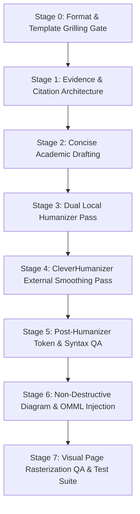

# Humanizer for DOCX: Scientific Document Engineering & Coherence Test Suite

A publication-grade engineering framework and automated testing suite for preparing, humanizing, and assembling academic research manuscripts in Microsoft Word (`.docx`).

Combines local AI-tell heuristic scanners, paragraph burstiness/coherence metrics, external sentence smoothing via [CleverHumanizer](https://cleverhumanizer.ai/), non-destructive VML diagram injection, and automated OpenXML structure verification.

---

## Key Features

- **Format Grilling Gate (Phase 0)**: Interactive user interview before touching layout; never assumes hardcoded document formats.
- **Dual Local Humanizer Pipeline**: Combines `blader/humanizer` v3.1.0 (24 Wikipedia AI writing patterns) with `the-humanizer` v2.4 (burstiness, tone, and sentence-length variance scoring).
- **Automated Coherence & Burstiness Verification**: Verifies sentence-length standard deviation ($\sigma \ge 3.5$) and lexical cohesion ($\ge 65\%$).
- **Post-Humanizer Token Integrity**: Automatically flags broken web humanizer artifacts (`skimage. feature`, broken commas `1, 704`).
- **Citation Bijection & Density Audit**: Verifies complete 1-to-1 bijection between body citations and Section IV reference list; prohibits lazy range clusters (`[1]-[6]`).
- **Non-Destructive VML Diagram Injection**: Safely updates Figure 1–6 bounding boxes and media assets inside Word-saved DOCX files without modifying text runs.
- **Native OpenXML Math**: Converts LaTeX/ASCII formulas to native, editable `<m:oMath>` equations.

---

## Directory Architecture

```
humanizer-for-docx/
├── .agents/skills/                   # 9 modular agent skills
│   ├── citation-management/         # Crossref & BibTeX reference verification
│   ├── graphify/                    # Codebase & document relationship graphing
│   ├── humanizer/                   # blader/humanizer v3.1.0 pattern eradication
│   ├── literature-review/           # Systematic research synthesis
│   ├── peer-review/                 # Academic peer review checklist
│   ├── scientific-critical-thinking/# Bias & experimental design evaluation
│   ├── scientific-writing/          # Concise academic drafting
│   ├── the-humanizer/               # the-humanizer v2.4 burstiness & scoring
│   └── word-writing/                # OpenXML & native OMML equation engineering
├── tasks/
│   └── research-tools.md            # Research tooling setup & workflow instructions
├── workflows/
│   ├── cleverhumanizer-docx-workflow.md  # Detailed 8-stage humanizer & DOCX guide
│   └── thesis-architecture-guide.md      # Scientific guide to Local Flora thesis
├── scripts/
│   ├── redraw_diagrams.cjs          # Sharp-based high-DPI vector diagram generator
│   ├── update_diagrams_only.py      # Non-destructive in-place VML shape updater
│   ├── repair_word_equations.ps1    # PowerShell OpenXML native equation builder
│   └── render_docx_qa.ps1           # Word COM & Metafile page-by-page visual rasterizer
├── tests/
│   ├── test_coherence_and_humanizer.py  # Burstiness, cohesion, token integrity, AI tells
│   ├── test_citation_density.py         # Bijection, continuous indexing, density check
│   ├── test_docx_integrity.py           # XML elements, OMML math, VML shapes, page budget
│   └── run_all_docx_tests.py            # Unified test harness with summary table & report
├── AGENTS.md                        # Local agent instructions & Phase 0 Grilling Gate
├── .gitignore                       # Git exclusion rules (ignores raw docx/pdf/caches)
└── README.md                        # Repository overview & usage documentation
```

---

## Quick Start

### 1. Run the Complete Automated Test Suite

```bash
# Run all tests against target DOCX
python tests/run_all_docx_tests.py --docx path/to/manuscript.docx

# Export a structured Markdown report
python tests/run_all_docx_tests.py --docx path/to/manuscript.docx --report-out audit_report.md
```

### 2. Run Individual Verification Modules

```bash
# Test prose rhythm, lexical cohesion, and AI vocabulary
python tests/test_coherence_and_humanizer.py --docx path/to/manuscript.docx

# Audit citation density and Section IV reference bijection
python tests/test_citation_density.py --docx path/to/manuscript.docx --expected-refs 25

# Audit XML structure, native equations, diagrams, and page budget
python tests/test_docx_integrity.py --docx path/to/manuscript.docx --columns 2 --expected-figures 6
```

### 3. Visual Layout Page Rasterization

```powershell
powershell -ExecutionPolicy Bypass -File scripts/render_docx_qa.ps1 -DocxPath path/to/manuscript.docx -OutDir tmp/docx-qa
```

---

## The 8-Stage Publication-Grade Workflow



For the step-by-step implementation guide, see [workflows/cleverhumanizer-docx-workflow.md](workflows/cleverhumanizer-docx-workflow.md).

For the experimental rationale of the smartphone flora study, see [workflows/thesis-architecture-guide.md](workflows/thesis-architecture-guide.md).

---

## Included Agent Skills (9 Skills)

| Skill | Directory | Core Capability |
| :--- | :--- | :--- |
| **citation-management** | `.agents/skills/citation-management/` | Crossref, PubMed, and Google Scholar bibliographic verification and BibTeX parsing. |
| **graphify** | `.agents/skills/graphify/` | Knowledge graph generation across codebase and academic prose. |
| **humanizer** | `.agents/skills/humanizer/` | Heuristic removal of 24 Wikipedia AI writing patterns (`blader/humanizer` v3.1.0). |
| **the-humanizer** | `.agents/skills/the-humanizer/` | Content-type detection, burstiness scoring, and authentic human voice shaping. |
| **literature-review** | `.agents/skills/literature-review/` | Systematic literature reviews, evidence screening, and synthesis tracking. |
| **peer-review** | `.agents/skills/peer-review/` | Structured academic peer-review critique and revision response planning. |
| **scientific-critical-thinking** | `.agents/skills/scientific-critical-thinking/` | Evaluation of study design, bias, confounding, and statistical validity. |
| **scientific-writing** | `.agents/skills/scientific-writing/` | Evidence-grounded academic manuscript drafting and reporting-guideline compliance. |
| **word-writing** | `.agents/skills/word-writing/` | Microsoft Word DOCX styling, typography, and native OpenXML equation engineering. |

---

## Compliance & Privacy Standards

- **Strictly Private Git Defaults**: Always default to `--private` on `gh repo create`.
- **Zero Raw Document Commit**: `.gitignore` strictly ignores `.docx`, `.pdf`, `~$*.docx`, and `node_modules/`.
- **Evidence Traceability**: No fabricated citations, synthetic results, or unverified statistical claims.

