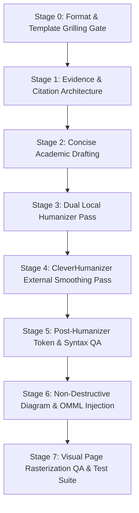

# CleverHumanizer + DOCX Engineering Workflow

This guide details the complete 8-stage methodology for preparing, humanizing, and assembling publication-ready academic manuscripts in Microsoft Word (`.docx`), preserving native OpenXML equations, diagram geometry, and flawless citation bijection.

---

## Workflow Overview



---

## Stage 0: Format Discovery & User Grilling Gate

> [!CRITICAL]
> **NEVER ASSUME DEFAULT LAYOUT PARAMETERS.**
> Different journals, conferences, and universities require completely incompatible layouts (single vs. double column, APA vs. IEEE citations, A4 vs. Letter margins). Never write a single document line before interviewing the user.

### Interactive Grilling Checklist

Run an interactive dialog with the user covering:

1. **Document Origin**:
   - Is there an existing `.docx` draft to edit in-place?
   - Or are we synthesizing a clean file from scratch?
2. **Template Document**:
   - Does the user possess an official `.docx` template or `.pdf` style guide?
   - If provided, unpack the template with Python (`python -c "import zipfile..."`) and read:
     - Section margin dimensions (`<w:pgMar>`)
     - Column architecture (`<w:cols>`)
     - Default body font (`<w:rFonts>`) and size (`<w:sz>`)
     - Line spacing (`<w:spacing>`)
3. **Typography & Layout Parameters (if no template exists)**:
   - Paper size: A4 (`210 × 297 mm`) vs. US Letter (`8.5 × 11 in`)
   - Column layout: 1 column (thesis / dissertation) vs. 2 columns (IEEE conference / ACM journal)
   - Font family and size: Times New Roman 10pt (IEEE standard) vs. Times New Roman 12pt (APA thesis)
   - Target length: Page budget (e.g., 4–6 pages concise vs. full 20+ page manuscript)
4. **Citation & Humanizer Constraints**:
   - Number of target references (e.g., 25–35)
   - Citation convention: IEEE brackets (`[1]`) or APA author-date
   - Max citations per sentence (enforce strict single-citation rule or allow multi-citation sentences)
   - CleverHumanizer integration confirmation

---

## Stage 1: Evidence & Citation Architecture Gate

1. **Reference Corpus Verification**:
   - Use `literature-review` and `citation-management` skills.
   - Verify every bibliographic entry against Crossref, PubMed, or official herbarium registries.
   - Prohibit hallucinated citations, synthetic author lists, or placeholder DOIs.
2. **Single-Citation Discipline**:
   - Prohibit lazy citation clusters such as `[1]-[6]` or `[1], [2], [3]`.
   - Each citation must directly justify a specific operational or experimental claim (e.g., `"Noyan demonstrated that background shortcuts inflate classifier accuracy [6]."`).
3. **Continuous Indexing**:
   - Ensure references form an unbroken numerical sequence `[1]` through `[N]`.
   - Every single reference in Section IV must be cited in the body text (100% bijection).

---

## Stage 2: Concise Academic Drafting

1. **Direct Operational Focus**:
   - Use the `scientific-writing` skill.
   - Eliminate filler background prose and focus on:
     - The operational problem (in situ smartphone recognition in natural backgrounds).
     - Controlled experimental methodology (Protocol A vs. Protocol B).
     - Concrete technical parameters (MobileNetV3-Large, GLCM, LBP, HOG, HSV, SVM, XGBoost).
2. **Strict Page Budget Enforcement**:
   - For a concise 4–6 page manuscript, maintain 2,800 to 4,200 words for Chapters I–III.
   - Keep paragraphs balanced (4 to 7 sentences each) with clear thematic topic sentences.

---

## Stage 3: Dual Local Humanizer Pass

Run two complementary local heuristic filters:

1. **`blader/humanizer` v3.1.0 (Wikipedia AI-Tell Eradication)**:
   - Eliminates 24 specific signs of AI writing:
     - Forced syntactic contrast structures (*"Not only X, but also Y"*).
     - Dramatic cliffhanger closures (*"Let that sink in"*, *"Only time will tell"*).
     - Promotional / buzzword vocabulary (*delve*, *tapestry*, *testament to*, *pivotal*, *underscores*, *realm*, *elevate*).
     - Excessive em-dashes (`—`).
2. **`the-humanizer` v2.4 (Rhythm & Burstiness Scoring)**:
   - Measures sentence-length variance across every paragraph.
   - Human academic prose exhibits **burstiness**: alternating concise declarative sentences (8–14 words) with complex compound formulations (25–38 words).
   - Target sentence-length standard deviation: $\sigma \ge 3.5\text{ words}$ (typically 7–10 words in polished human writing).

---

## Stage 4: External Paragraph Coherence Pass via CleverHumanizer

When local heuristics pass, export section text for external flow optimization:

1. **Web Interface Usage**:
   - Navigate to [CleverHumanizer](https://cleverhumanizer.ai/).
   - Submit text section by section (1 to 2 paragraphs per pass).
   - Set output tone to **Academic / Formal**.
2. **Why CleverHumanizer?**:
   - Smooths adjacent-sentence semantic transitions without dumbing down technical vocabulary.
   - Ensures high lexical cohesion ($\ge 65\%$ consecutive sentences connected by shared content words or discourse transition markers).
3. **The Microsoft Word VML Conversion Phenomenon**:
   - When text polished in web tools is pasted back into Microsoft Word and saved as `.docx`, Word’s layout engine rewires modern DrawingML `<w:drawing>` containers into legacy VML `<v:shape>` nodes.
   - This causes conventional python-docx scripts to crash or delete diagram figures!
   - This repository solves that exact problem using Stage 6.

---

## Stage 5: Post-Humanizer Token & Terminology Integrity QA

Web humanizers frequently introduce spacing and tokenization errors. Our automated suite detects and corrects them:

1. **Spaced-Dot Code Identifiers**:
   - Web humanizers mistake code periods for punctuation:
     - *Artifact*: `skimage. feature` $\to$ *Fix*: `skimage.feature`
     - *Artifact*: `cv2. imread` $\to$ *Fix*: `cv2.imread`
     - *Artifact*: `scipy. stats` $\to$ *Fix*: `scipy.stats`
2. **Broken Thousands Separators**:
   - Web humanizers insert spaces after commas in large numbers:
     - *Artifact*: `1, 704` $\to$ *Fix*: `1,704`
     - *Artifact*: `2, 000` $\to$ *Fix*: `2,000`
3. **Synonym Degradation of Core Terms**:
   - Ensure the humanizer did not substitute domain terms with layman synonyms:
     - *Preserved*: `MobileNetV3-Large`, `GLCM`, `LBP`, `HOG`, `HSV`, `SVM`, `XGBoost`, `Macro F1`, `Protocol A`, `Protocol B`.

---

## Stage 6: Non-Destructive VML Diagram & OMML Math Injection

To preserve humanized prose and avoid XML corruption, use our dedicated surgical scripts:

1. **Redraw High-DPI Diagram Assets**:
   ```bash
   node scripts/redraw_diagrams.cjs
   ```
   Renders Figures 1 through 6 to crisp PNGs and produces `manifest.json` containing exact pixel aspect ratios.

2. **In-Place VML Update**:
   ```bash
   python scripts/update_diagrams_only.py --docx output/Local_Flora_Concise_Smartphone.docx --diagrams-dir tmp/chapters/revised-diagrams
   ```
   - Modifies *only* the VML `<v:shape style="width:243.25pt;height:...pt">` dimensions and replaces binary images in `word/media/image1.png`..`image6.png`.
   - **Zero paragraph text is modified.**

3. **Native OpenXML Math Equation Repair**:
   ```powershell
   powershell -ExecutionPolicy Bypass -File scripts/repair_word_equations.ps1
   ```
   Converts ASCII formulas into native, beautifully formatted `<m:oMath>` equations.

---

## Stage 7: Visual Page Rasterization QA & Test Execution

1. **Automated Document Test Harness**:
   ```bash
   python tests/run_all_docx_tests.py --docx output/Local_Flora_Concise_Smartphone.docx
   ```
   Verifies:
   - Burstiness $\ge 3.5$ words
   - Lexical cohesion $\ge 65\%$
   - Reference bijection (all 31 references cited in body)
   - Zero raw LaTeX leaks
   - All 6 figures and 3 tables present
   - Concise page budget (6 pages)

2. **Visual Page-by-Page Rendering**:
   ```powershell
   powershell -ExecutionPolicy Bypass -File scripts/render_docx_qa.ps1 -DocxPath output/Local_Flora_Concise_Smartphone.docx -OutDir tmp/docx-qa
   ```
   Exports native page metafiles to `tmp/docx-qa/page-1.png` .. `page-6.png` for complete visual layout verification.
