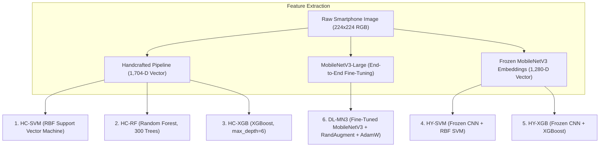

# Thesis Architecture Guide

**Full Title**: *Quantifying the Generalization Gap: A Comparative Study of Lightweight Deep Learning and Feature-Engineered Classical Machine Learning for In Situ Local Flora Classification*

---

## 1. Executive Research Premise

### Why This Thesis Does NOT Benchmark Multiple Heavy Deep Networks
In agricultural and botanical computer vision, many published papers conduct superficial model shootouts across ResNet50, DenseNet121, VGG16, and InceptionV3. This study explicitly avoids that pattern for two critical scientific and operational reasons:

1. **Operational Edge Deployment Constraint**:
   Rural agricultural monitoring, forestry inventory, and community science in developing regions require **offline smartphone inference** on low-tier consumer Android hardware without cloud latency or costly data plans. Heavy 100M+ parameter backbones are computationally non-viable for sustained field battery life.
2. **Direct Paradigm Comparison**:
   Instead of testing minor architectural variations within deep learning, this thesis investigates a fundamental machine learning question:
   > *When evaluated on truly unseen physical specimens in complex natural backgrounds, does an end-to-end mobile deep learning model (`MobileNetV3-Large`) maintain its performance advantage over classical, interpretable feature engineering (`GLCM + LBP + HOG + HSV`), or does it suffer a disproportionate generalization collapse?*

---

## 2. In Situ Smartphone Dataset Architecture

The experimental corpus consists of **2,000 original smartphone photographs** collected in Lanao del Norte, Philippines (across Mindanao State University – Maigo College of Education, Science and Technology [MSU-MCEST], Maigo, and Kolambugan):

| Parameter | Specification | Scientific Rationale |
| :--- | :--- | :--- |
| **Target Species ($C$)** | 10 local flora species | Culturally significant medicinal, edible, and ornamental flora |
| **Physical Specimens ($S$)** | 10 independent plants per species ($N=100$) | Each physical plant assigned a strict `plant_id` |
| **Photos per Plant ($P$)** | 20 smartphone captures | 5 canonical view angles across varying diurnal illumination |
| **Total Images ($N$)** | **2,000 images** ($10 \times 10 \times 20$) | Balanced class distribution across all categories |

### The 5 Standardized Smartphone Acquisition Angles
To prevent viewpoint memorization, each physical plant is documented across 5 realistic user capture perspectives:
1. **Top-down nadir view**: Captures leaf phyllotaxy and rosette geometry.
2. **Oblique 45° angle #1**: Simulates casual standing handheld photography.
3. **Oblique 45° angle #2**: Rotated 90° azimuthally around the canopy.
4. **Lateral leaf/stem macro close-up**: Resolves venation, trichomes, and margin serrations.
5. **Whole-plant habit shot**: Situates the plant within natural background soil, rocks, weeds, and companion flora.

---

## 3. The 6 Controlled Classification Pipelines

To isolate the exact contribution of feature engineering vs. deep representation learning, we design 6 tightly controlled pipelines:



### Detailed Pipeline Specifications

1. **`HC-SVM` (Handcrafted + SVM)**:
   - **Feature Vector**: 1,704 dimensions combining:
     - *Texture*: 72-D Gray-Level Co-occurrence Matrix (GLCM; 4 angles $\times$ 3 distances $\times$ 6 Haralick statistics)
     - *Microtexture*: 36-D Uniform Local Binary Patterns ($LBP_{8,1}^{u2}$ across 3 color channels)
     - *Shape/Structure*: 1,296-D Histogram of Oriented Gradients (HOG; $8\times 8$ cells, $2\times 2$ blocks, 9 bins)
     - *Color Distribution*: 300-D HSV Color Histogram ($12 \times 5 \times 5$ bins)
   - **Classifier**: Support Vector Machine with Radial Basis Function kernel ($C=10.0, \gamma=\text{'scale'}$).
2. **`HC-RF` (Handcrafted + Random Forest)**:
   - 1,704-D feature vector trained on 300 de-correlated decision trees with Gini impurity splitting.
3. **`HC-XGB` (Handcrafted + XGBoost)**:
   - 1,704-D feature vector with extreme gradient boosting (`learning_rate=0.05`, `max_depth=6`, `subsample=0.8`).
4. **`HY-SVM` (Hybrid Control 1)**:
   - 1,280-D deep feature vector extracted from the frozen global average pooling layer of pretrained MobileNetV3-Large, classified by RBF SVM. Isolates representation quality from classifier architecture.
5. **`HY-XGB` (Hybrid Control 2)**:
   - 1,280-D frozen deep embedding classified by XGBoost.
6. **`DL-MN3` (End-to-End Deep Learning)**:
   - MobileNetV3-Large fine-tuned end-to-end on $224 \times 224$ RGB inputs.
   - Training regimen: AdamW optimizer, initial learning rate $1 \times 10^{-4}$, cosine annealing decay, RandAugment data augmentation, cross-entropy loss with label smoothing (0.1).

---

## 4. Protocol A vs. Protocol B: Quantifying the Generalization Gap

The central thesis hypothesis is that standard image-level cross-validation suffers from **data leakage**, masking severe brittleness under real-world smartphone conditions.

```mermaid
flowchart LR
    subgraph Protocol A: Random Image Split (Leaky)
        A1["2,000 Images"] --> A2["70% Train (1,400)"]
        A1 --> A3["15% Val (300)"]
        A1 --> A4["15% Test (300)"]
        A_NOTE["Photos of SAME Plant Appear in BOTH Train & Test!"]
    end

    subgraph Protocol B: Grouped Specimen Split (Disjoint)
        B1["100 Physical Plants (plant_id)"] --> B2["Fold 1..5 StratifiedGroupKFold"]
        B3["8 Plants/Species Train (1,600)"]
        B4["2 Plants/Species Test (400)"]
        B_NOTE["ZERO Specimen Overlap: Evaluates UNSEEN Physical Plants!"]
    end
```

### The Generalization Gap Formula
For any evaluation metric $M$ (Macro F1 or Top-1 Accuracy):

$$\Delta_M = M_{\text{Protocol A}} - M_{\text{Protocol B}}$$

- **Protocol A (Random Image Split)**:
  - 1,400 train, 300 validation, 300 test images randomly partitioned without regard to plant identity.
  - *Vulnerability*: The classifier memorizes specific background objects (pots, soil types, companion weeds) as demonstrated by **Noyan's PlantVillage benchmark**, where classifying the 8 corner background pixels achieved 49% accuracy without observing the plant.
- **Protocol B (5-Fold Specimen-Disjoint Cross-Validation)**:
  - Partitioned using `StratifiedGroupKFold` grouped strictly by `plant_id`.
  - In every fold, 80 physical plants (1,600 images) are used for training and 20 complete physical plants (400 images) are held out for testing.
  - *True Generalization*: Tests whether the model can classify an unfamiliar plant photographed by a farmer or student in the field.

---

## 5. Statistical & Mobile Efficiency Metrics

1. **Classification Metrics**:
   - Class-balanced **Macro F1** (harmonic mean of per-class precision and recall).
   - **Top-1 Accuracy**.
   - Generalization Gap **$\Delta_{\text{F1}}$** and **$\Delta_{\text{Acc}}$**.
2. **Statistical Rigor**:
   - Paired **Wilcoxon signed-rank test** across the 10 species between pipelines.
   - Multi-hypothesis error control via the **Holm-Bonferroni step-down correction** ($\alpha = 0.05$).
3. **On-Device Mobile Deployment Profiling**:
   - Single-thread CPU inference latency on Snapdragon 680 (milliseconds per image).
   - Peak RAM consumption (MB).
   - Compiled model storage footprint (MB; FP32 vs. INT8 quantized).

---

## 6. Visual Logic & Structural Annotation of Figures 1–6

| Figure | Caption Title | Visual Logic & Architectural Role |
| :---: | :--- | :--- |
| **1** | Research Gap in In Situ Recognition | Visualizes the transition from pristine laboratory bench setups (sterile white backgrounds) to variable field environments, demonstrating how background shortcut learning creates an artificial generalization gap. |
| **2** | Conceptual Framework | Complete IPO (Input-Process-Output) diagram linking verified local flora species and standardized smartphone photography through the 6 pipelines to quantified metrics and mobile deployment. |
| **3** | In Situ Dataset Acquisition | Matrix diagram illustrating the 10 target flora classes $\times$ 10 specimens $\times$ 5 canonical smartphone acquisition angles (nadir, 45° oblique #1, 45° oblique #2, lateral close-up, habit shot). |
| **4** | Controlled 6-Pipeline Architecture | System diagram showing the feature extraction branches (1,704-D handcrafted vector vs. 1,280-D frozen embeddings vs. fine-tuned CNN) feeding into SVM, Random Forest, XGBoost, and MobileNetV3. |
| **5** | Protocol A vs. Protocol B Partitioning | Side-by-side comparison illustrating how Protocol A shuffles image-level files (allowing background leakage) while Protocol B enforces specimen-level group isolation via `StratifiedGroupKFold`. |
| **6** | Statistical & Efficiency Evaluation | Flowchart of the evaluation harness: Macro F1 extraction, paired Wilcoxon testing with Holm-Bonferroni correction, and hardware benchmarking (CPU latency, RAM, model size). |
